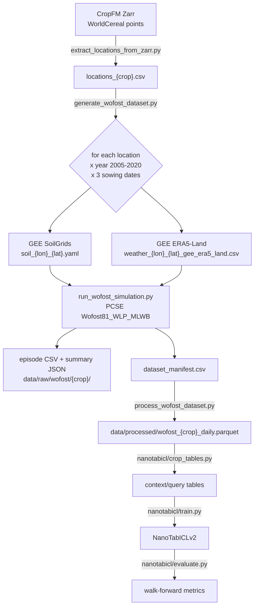

# Manual: from WOFOST simulations to NanoTabICL

A walkthrough of the code in this repo, in the order the data
flows: where the simulated seasons come from and which assumptions they make,
how they're stored and processed, what the model is and how it works inside,
and how training and evaluation tables are built. Every section points to the
file (and function) that does it.

Contents

1. [Overview](#1-overview)
2. [Locations](#2-locations)
3. [Simulating a season with WOFOST](#3-simulating-a-season-with-wofost)
4. [Assumptions of the simulations](#4-assumptions-of-the-simulations)
5. [Raw data on disk](#5-raw-data-on-disk)
6. [Processing: one row per season](#6-processing-one-row-per-season)
7. [Data checks](#7-data-checks)
8. [From rows to model features](#8-from-rows-to-model-features)
9. [The model: NanoTabICLv2 (TabICLv2)](#9-the-model-nanotabiclv2-tabiclv2)
10. [Checkpoints](#10-checkpoints)
11. [Training tables: structured and random](#11-training-tables-structured-and-random)
12. [Evaluation tables: walk-forward](#12-evaluation-tables-walk-forward)
13. [The training loop](#13-the-training-loop)
14. [The TabICLv2 prior (synthetic tables)](#14-the-tabiclv2-prior-synthetic-tables)
15. [Commands, in order](#15-commands-in-order)
16. [Known simplifications and open points](#16-known-simplifications-and-open-points)

---

## 1. Overview



The unit throughout is a **season**: one location × one sowing year × one
sowing date (jitter). One season = one row of the final table, the same
unit as a CYBench row (a region × a season).

| stage | code | output |
|---|---|---|
| pick locations | [`src/data_pipeline/locations/extract_locations_from_zarr.py`](../src/data_pipeline/locations/extract_locations_from_zarr.py) | `data/raw/locations/locations_{crop}.csv` |
| simulate | [`src/data_pipeline/wofost/generate_wofost_dataset.py`](../src/data_pipeline/wofost/generate_wofost_dataset.py) → [`run_wofost_simulation.py`](../src/data_pipeline/wofost/run_wofost_simulation.py) | `data/raw/{soilgrids_gee,weather,wofost}/…` + `dataset_manifest.csv` |
| check | [`src/data_checks/`](../src/data_checks/) | `data/reports/dataset_checks/…` |
| process | [`src/data_pipeline/wofost/process_wofost_dataset.py`](../src/data_pipeline/wofost/process_wofost_dataset.py) | `data/processed/wofost_{crop}_daily.parquet` |
| tables | [`nanotabicl/crop_tables.py`](../nanotabicl/crop_tables.py) | in memory |
| model | [`nanotabicl/model.py`](../nanotabicl/model.py), [`checkpoint.py`](../nanotabicl/checkpoint.py) | — |
| train / evaluate | [`nanotabicl/train.py`](../nanotabicl/train.py), [`evaluate.py`](../nanotabicl/evaluate.py) | `logs/nanotabicl/<run>/` |

The column-by-column description of the files is in
[`docs/data_dictionary.md`](data_dictionary.md).

---

## 2. Locations

[`extract_locations_from_zarr.py`](../src/data_pipeline/locations/extract_locations_from_zarr.py)

- **Source:** the CropFM dataset Zarr. Every sample in it is a point on
  WorldCereal temporary cropland, with `metadata/sample_info` (sample id,
  country, longitude, latitude, …) — `load_locations_from_zarr`.
- **Crop filter** (`--crop`): keeps only points where the WorldCereal 2021
  crop-type map says that crop — `worldcereal_crop_codes()`: maize = code 1,
  wheat = code 2 (*winter* cereals, because the simulated variety is winter
  wheat).
- It also copies the WorldCereal crop calendar's start/end of season for that
  crop into `sos_doy` / `eos_doy` (but see [§4](#4-assumptions-of-the-simulations):
  the simulation doesn't use them yet).
- **Sampling** (`sample_locations`): optional country filter (names or the
  group `nw_europe`), then `-n` random points in total or per country
  (`--per-country`), with `--seed`.
- **Spatially even alternative** ([`grid_sample_locations.py`](../src/data_pipeline/locations/grid_sample_locations.py)):
  crop points in the EU (`eu27` group, minus `--holdout-countries`), one random point per 0.1° cell
  (cells centred on multiples of 0.1°, like ERA5-Land, so one cell = one weather pixel), then `-n` cells
  at random (seeded). Locations follow where the crop is grown. Writes
  `locations_{crop}_eu27_cell01_n{n}_s{seed}.csv` (same columns + `cell_id`) and a per-country count table.
- **Output:** `data/raw/locations/locations_{crop}.csv`. **Its row number is
  the `location_index`** used everywhere downstream; the processing step joins
  the `country` column back on that row number.

---

## 3. Simulating a season with WOFOST

### 3.1 The batch runner

[`generate_wofost_dataset.py`](../src/data_pipeline/wofost/generate_wofost_dataset.py) — `generate_wofost_dataset`

- Every location gets **every sowing year in 2005–2020** (`--start-year`,
  `--end-year`) and per year **3 sowing dates** (`--num-jitters`): distinct
  random offsets within **±10 days** (`--sowing-jitter-days`) of the crop's
  season start (`_sample_jitter_offsets`). So a location has 16 × 3 = 48
  seasons.
- All offsets are drawn up front from one seeded RNG, so `--seed` gives the
  same seasons whatever the number of workers.
- Locations run in parallel worker processes (`--workers`, default
  min(8, CPUs)); seasons that share coordinates go to the same worker because
  the soil/weather caches are one file per coordinate (`_run_location_group`).
- Before a location's seasons run, its weather for the whole year window is
  fetched once (`_prefetch_weather_for_window`).
- A failing season (e.g. an Earth Engine quota error) is written to the
  manifest with `status="failed"` and the batch continues. The manifest is
  rewritten after every finished location, so a crash loses nothing.

### 3.2 One season

[`run_wofost_simulation.py`](../src/data_pipeline/wofost/run_wofost_simulation.py) — `generate_wofost_episode`

1. **Sowing date** = 1 January of the sowing year + season start − 1 +
   offset (`agromanagement.sowing_date_from_offset`). The season start is the
   location's WorldCereal SOS (`sos_doy` in the locations CSV, passed by the
   batch runner), else `default_sowing_doy()[crop]`.
2. **Soil** — `generate_gee_soil_file.generate_soil_data_for_wofost` ([§3.3](#33-soil)).
3. **Weather** for the campaign, from season start − 60 days
   (`default_pre_season_days()`, CY-Bench's `sos-60`) to max(EOS, sowing +
   max duration) + 1 day — `gee_weather.get_gee_weather_provider_for_location`
   ([§3.4](#34-weather)).
4. **Parameters** — `pcse_runner.build_parameter_provider`: crop parameters
   (YAML), the soil profile, site parameters.
5. **Agromanagement** — `agromanagement.build_agromanagement`: one campaign
   starting at season start − 60 days, crop from the sowing date to maturity
   (`max_duration` cap), **no events** (no fertiliser, no irrigation), and a
   trailing empty campaign at the end date above.
6. **Run** — `pcse_runner.run_wofost`: PCSE's engine runs day by day over the
   whole campaign. The multi-layer soil water balance runs on bare soil
   before sowing and after maturity; the crop runs from sowing to maturity
   (DVS = 2) or the max duration, its columns are empty outside that.
   Per-layer outputs (soil moisture `SM`, water content `WC`) are flattened
   into `SM_layer0…`, `WC_layer0…` columns.
7. **Derived features** — `pcse_runner.merge_weather_and_derive_features`
   joins the daily weather and adds:
   - `cwb = RAIN − ET0` (climatic water balance),
   - `fpar = 1 − exp(−k(DVS) · LAI)` with `k` from the crop's `KDIFTB`
     table (fraction of light absorbed by the canopy), 0 when there is no crop,
   - `ssm = SM_layer0` (simulated moisture of the top 0–5 cm layer, the
     closest match to CYBench's satellite surface soil moisture).
8. **Save** the daily trajectory CSV and a summary JSON (yield = `TWSO`,
   final DVS, `awc`, `bulk_density`).

### 3.3 Soil

[`generate_gee_soil_file.py`](../src/data_pipeline/soil/generate_gee_soil_file.py),
[`utils_soil/gee_soilgrids.py`](../src/data_pipeline/soil/utils_soil/gee_soilgrids.py),
[`utils_soil/generate_soil_files.py`](../src/data_pipeline/soil/utils_soil/generate_soil_files.py),
[`utils_soil/soil_static_features.py`](../src/data_pipeline/soil/utils_soil/soil_static_features.py)

1. **SoilGrids (250 m) via Google Earth Engine** at the point: clay, sand,
   silt, organic carbon, bulk density, pH, nitrogen, at **6 depths**
   (0–5, 5–15, 15–30, 30–60, 60–100, 100–200 cm) — `get_df_soilgrids_gee`,
   `default_zs()`. Raw integers are scaled to physical units
   (`default_soilgrid_d_factors`).
2. **Water-retention curves:** the Wösten pedotransfer functions turn texture,
   bulk density and organic matter into **van Genuchten** parameters per layer
   (`calculate_van_genuchten`, `PedotransferFunctionsWosten`; organic matter =
   SOC × 0.58 × 0.1, residual moisture fixed at 0.01).
3. **PCSE soil profile:** for each layer, soil moisture and log-conductivity
   are tabulated against pF (`generate_df_soil_input`) and written as a
   multi-layer `SoilProfileDescription` (`generate_soil_yaml`): field capacity
   pF 2.0, wilting point pF 4.2, **no groundwater**, rootable depth `RDMSOL` =
   200 cm, subsoil = the deepest layer.
4. **Static features** from the **top layer** (`compute_topsoil_static_features`):
   `bulk_density` = SoilGrids' value; `awc` = moisture at pF 2.0 − moisture
   at pF 4.2 (available water capacity, cm³/cm³).
5. **Cache:** `data/raw/soilgrids_gee/soil_{lon}_{lat}.yaml` +
   `soil_{lon}_{lat}_static_features.json`. An existing file is reused
   (soil depends only on location).

### 3.4 Weather

[`utils_weather/gee_weather.py`](../src/data_pipeline/weather/utils_weather/gee_weather.py)

- **Source:** ERA5-Land daily aggregates on Earth Engine
  (`ECMWF/ERA5_LAND/DAILY_AGGR`, ~0.1° grid), plus elevation (GMTED2010).
- **Conversion to PCSE units** (`era5_land_to_pcse_records`): temperatures
  K → °C (`TMIN`, `TMAX`, `TEMP` = daily mean), precipitation m → cm/day,
  radiation J/m²/day, vapour pressure from the dew point, 10 m wind → 2 m.
- **Evapotranspiration:** PCSE's `reference_ET` (Penman / Penman-Monteith) →
  `E0`, `ES0`, `ET0`; Ångström coefficients estimated from the data
  (`_estimate_angstrom_ab`).
- **Cache:** one file per location,
  `data/raw/weather/weather_{lon}_{lat}_gee_era5_land.csv`; only the missing
  years are requested, in chunks (Earth Engine memory limits).

---

## 4. Assumptions of the simulations

| assumption | value | where |
|---|---|---|
| model | `Wofost81_WLP_MLWB`: **water-limited** production, **multi-layer** soil water balance, **no nitrogen** | `default_wofost_variables.wofost_model_name` |
| crops / varieties | wheat = `Winter_wheat_101`, maize = `Grain_maize_201`; one variety per crop, not randomised | `default_crop_variety` |
| crop parameters | `WOFOST_crop_parameters`, `wofost81` branch of the herman-berghuijs fork (has the C4 / maize fix), cloned to `data/crop_parameters/wofost81` | `default_crop_parameters_dir`, `pcse_runner.load_crop_data_provider` |
| sowing date | **fixed day of year per crop, the same everywhere**: wheat 288 (~15 Oct), maize 121 (~1 May), ± up to 10 days jitter. The WorldCereal per-location season start (`sos_doy` in the locations CSV) is **not used yet** | `default_sowing_doy`, `agromanagement.py` |
| season end | at maturity (DVS = 2), or forced after 365 days (wheat) / 240 days (maize) | `default_max_duration_days`, `build_agromanagement` |
| management | no fertiliser, no irrigation, no other events | `build_agromanagement` |
| site | initial soil water `WAV` = 50, CO₂ = 360 ppm (constant over years), `NAVAILI` = 80 (unused without N) | `default_site_parameters` |
| rooting depth | the crop's max rooting depth is clamped down to a soil-layer boundary (e.g. wheat 125 → 100 cm), a PCSE requirement | `pcse_runner._override_rooting_depth_if_needed` |
| soil | SoilGrids + Wösten pedotransfer functions, 6 layers to 200 cm, no groundwater | [§3.3](#33-soil) |
| weather | ERA5-Land reanalysis, ET0 by Penman-Monteith | [§3.4](#34-weather) |
| yield | `TWSO` (total weight of storage organs, kg dry matter/ha) at the end of the run | `run_wofost_simulation.py` |
| years | sowing years 2005–2020, all of them for every location | `generate_wofost_dataset.py` |

---

## 5. Raw data on disk

```
data/raw/
├── locations/locations_{crop}.csv                 # §2; row number = location_index
├── soilgrids_gee/
│   ├── soil_{lon}_{lat}.yaml                      # PCSE multi-layer soil profile
│   └── soil_{lon}_{lat}_static_features.json      # {"awc": ..., "bulk_density": ...}
├── weather/weather_{lon}_{lat}_gee_era5_land.csv  # daily PCSE weather records
└── wofost/
    ├── dataset_manifest.csv                       # one row per attempted season
    └── {crop}/
        ├── wofost_{crop}_{lon}_{lat}_{year}_{sowing_date}.csv           # daily trajectory
        └── wofost_{crop}_{lon}_{lat}_{year}_{sowing_date}_summary.json  # yield etc.
```

**`dataset_manifest.csv`** (written by `generate_wofost_dataset`) indexes every
season: `location_index, longitude, latitude, crop, year` (= sowing year),
`jitter_index, sowing_offset_days, status, error, sowing_date,
yield_kg_per_ha, final_dvs, awc, bulk_density, daily_path, summary_path`.
Note: every batch writes the same `dataset_manifest.csv` under its
`--output-dir`, so two crops run into the same directory overwrite each
other's manifest.

---

## 6. Processing: one row per season

[`process_wofost_dataset.py`](../src/data_pipeline/wofost/process_wofost_dataset.py) — `process_wofost_dataset`, `process_episode`

- Reads the manifest, keeps `status == "success"`, and for each season reads
  its daily CSV plus the location's weather cache.
- **Daily window** (`--align calendar`, default): CY-Bench's feature
  window, from the row's crop calendar: day 0 = SOS − 60 days, last day =
  EOS (`calendar_window`). Every row of a crop has the longest window's
  number of columns (maize: 268 days); a row is NaN after its own EOS.
  (`--align season_start` / `sowing`: the older fixed windows anchored on the
  placeholder season start / the sowing date.)
- **Daily columns** `{feature}_d{day:03d}`, for 10 features
  (`default_timeseries_features`), in CY-Bench's units:

  | feature | source | unit |
  |---|---|---|
  | `tmin`, `tmax`, `tavg` | weather | °C |
  | `prec` | weather | mm/day |
  | `rad` | weather | J/m²/day |
  | `et0` | weather | mm/day |
  | `cwb` = prec − et0 | weather | mm/day |
  | `fpar` | WOFOST | %; **0** outside the crop's life (bare field) |
  | `ssm` | WOFOST `WC` layers | kg/m², 0–10 cm (`soil_moisture_columns`) |
  | `rsm` | WOFOST `WC` layers | kg/m², 0–100 cm |

  Weather covers the whole window (it comes from the weather cache, not the
  episode), so it's complete even before sowing and after maturity.
- **Per-row values:** ids (`sample_id, location_index, location_id, country,
  crop`), `year` = **harvest year** (CYBench's convention; winter wheat sown
  Oct 2013 → 2014), `sowing_year`, `jitter_index`, statics (`latitude,
  longitude, awc` (cm/m), `bulk_density, sos_doy, eos_doy, sowing_doy`), metadata
  (`sowing_date, maturity_date, season_length_days, reached_maturity,
  window_start, window_end, …`),
  targets `yield_kg_per_ha` and `yield_t_per_ha`.
- `--locations-csv` adds `country` (joined on `location_index`).
- **Output** (`--format parquet` default):
  `data/processed/wofost_{crop}_daily.parquet` and
  `wofost_{crop}_daily_columns.json` (which columns belong to which group,
  window settings).

---

## 7. Data checks

[`src/data_checks/coverage_audit.py`](../src/data_checks/coverage_audit.py),
[`src/data_checks/simulation_audit.py`](../src/data_checks/simulation_audit.py)

- **Coverage audit:** locations / countries / crops, failures and their
  causes, year coverage, completeness of the location × year × jitter grid,
  duplicates, missing files.
- **Simulation audit:** yield distributions per country / year, runs that
  never matured, outliers, effect of the sowing jitter, phenology (flowering,
  maturity, season length), physical sanity of the daily trajectories (LAI,
  biomass, harvest index, water stress), and example curves per location.
- Both write `summary.md`, CSVs and figures to `data/reports/dataset_checks/…`.

---

## 8. From rows to model features

[`nanotabicl/crop_tables.py`](../nanotabicl/crop_tables.py) — `CropTables.__init__`, `CropTables._features`

On loading the processed table:

1. Drops seasons that **didn't reach maturity** and rows with a missing target.
2. Builds **one feature vector per row: CY-Bench's tabular features**
   ([`cybench_features.py`](../nanotabicl/cybench_features.py), spec in
   [`cybench_features.md`](cybench_features.md)), the exact columns
   AgML-CY-Bench-Modeling builds for its tabular models:
   - window SOS − 60 days → the `--horizon` cutoff (`eos` default), cut into
     30-day blocks counted back from the cutoff (block 0 = the last 30 days);
   - per block: `tmin_min, tmax_max, tavg_mean, prec_sum, prec_max, rad_mean,
     et0_mean, cwb_mean, gdd_sum, cum_gdd_max, cum_prec_max, cum_cwb_mean`
     (meteo), `fpar_mean, cum_fpar_max` (dekad dates only), `ssm_mean,
     rsm_mean`; columns `<name>_<block>`, sorted by name then block, per source;
   - statics `sos_sin, sos_cos, eos_sin, eos_cos, loc_x, loc_y, loc_z, awc,
     bulk_density`;
   - `vpd`, `ndvi`, `drainage_class` left out (not in WOFOST);
   - standardised with the benchmark's normaliser fitted on the train years
     (per variable, pooled over blocks), columns with > 5 % NaN dropped, NaN → 0.
   - Maize, `eos`: (12 + 2 + 2) × 9 + 9 = **153 features**.
3. Keeps `y` (target), `point` (= `location_index`) and `year`
   (= **sowing year**) per row, and an index `cells[(point, year)]` → the
   row(s) of that point and year (one per jitter).
4. **Regions** = countries. Regions with fewer than `--min-points` (10)
   points are dropped (`dropped_regions`, printed at the start of training).
5. **Year split** by sowing year: train 2005–2016 (`train_pool`), validation
   2017–2018, test 2019–2020.

---

## 9. The model: NanoTabICLv2 (TabICLv2)

[`nanotabicl/model.py`](../nanotabicl/model.py) (vendored unchanged from
[soda-inria/nanotabicl](https://github.com/soda-inria/nanotabicl)) — a
~170-line implementation of the TabICLv2 architecture. "Nano" refers to the
code, not the model: with the official dimensions it has 28.6M parameters.

### 9.1 What the model does

It's an **in-context learner**: a single forward pass takes a whole table

- `x`: `[B, rows, features]` — the first `n_train` rows are the **context**,
  the rest the **queries**;
- `y`: `[B, n_train]` — the targets of the context rows only;

and returns predictions for the query rows: `[B, rows − n_train, 999]`, the
**999 quantiles** of the predicted distribution of each query's target. No
weights change at prediction time: "learning" from the context happens inside
the forward pass, through attention. Training (§13) teaches the weights how to
do that.

Dimensions below are the official TabICLv2 regression model's: embedding
size d = 128, 3 column blocks, 3 row blocks, 12 ICL blocks, 8 heads, 128
inducing vectors, 4 CLS tokens.

### 9.2 Forward pass, step by step (`NanoTabICLv2.forward`)

```
x [B, R, C]                       R rows, C features, first n_train rows = context
 │ standardise each column with the context rows' mean/std
 │ feature grouping: column j -> (x_j, x_{j+1}, x_{j+3})       (circular shifts 0, 1, 3)
 │ x_embed: Linear(3 -> 128)                                    one token per CELL
 │ + y_embed_in(y): Linear(1 -> 128), added to every cell of the context rows
 ▼
emb [B, R, C, 128]
 │ 3 x column block  (attention along rows, separately per column)
 │ + 4 CLS tokens prepended to every row
 │ 3 x row block     (attention along features, separately per row; RoPE)
 │ keep the 4 CLS outputs, LayerNorm, concatenate
 ▼
row vectors [B, R, 512]
 │ + y_embed_icl(y): Linear(1 -> 512), added to the context rows
 │ 12 x ICL block    (attention between rows; every row attends to context rows only)
 │ LayerNorm, MLP 512 -> 1024 -> 999
 ▼
quantiles [B, R - n_train, 999]
```

1. **Standardisation.** Each feature column is standardised with the mean and
   standard deviation of the context rows (inside the model, so the query
   rows never influence it).
2. **Tokenisation: one token per cell.** Each cell becomes a 128-dim vector.
   "Feature grouping" gives each cell's embedding a look at two other
   columns: column j is embedded from `(x_j, x_{j+1}, x_{j+3})` (circularly
   shifted copies), through one `Linear(3 → 128)`. So a table has R × C
   tokens. **This is why memory and compute grow with the number of
   features.**
3. **Target-aware embedding.** The context rows' targets are embedded
   (`Linear(1 → 128)`) and added to every cell of those rows, so the column
   stage already sees how each feature relates to y.
4. **Column stage** — 3 × `InducedTransformerBlock`, applied with `col_attn`
   (each column is a sequence over rows, columns are independent):
   - 128 learned **inducing vectors** attend to the column's **context**
     cells (`tfm1`, `kv_max_idx=n_train`) and summarise its distribution;
   - every cell (context and query) attends to those 128 summaries (`tfm2`).
   This costs O(R × 128) per column instead of O(R²), and query rows can't
   leak into the summary. Result: each cell's embedding knows where its
   value sits within its column.
5. **Row stage** — 4 learned **CLS tokens** are prepended to every row, then
   3 × `TransformerBlock` with `row_attn` (each row is a sequence over its
   C + 4 tokens, rows are independent). **RoPE** (rotary position encoding,
   θ = 100 000) gives each column position an identity, so features with
   similar values can be told apart. The last block only computes the CLS
   outputs (`q_max_idx`); they're layer-normed and concatenated into **one
   512-dim vector per row** (4 × 128). Cost per row: O(C²) — quadratic in
   the number of features.
6. **ICL stage** (in-context learning) — the context rows' targets are added
   again (`Linear(1 → 512)`), then 12 × `TransformerBlock` over the rows:
   **every row attends only to the context rows** (`kv_max_idx=n_train`),
   which is where a query "compares itself" to the labelled rows. The last
   block computes only the query rows.
7. **Output head** — LayerNorm + MLP (512 → 1024 → 999): 999 quantiles at
   levels 0.001, 0.002, …, 0.999.

### 9.3 Inside a block

`TransformerBlock` (a subclass of `nn.MultiheadAttention`):

- **Pre-norm:** `x + attn(LN(x))`, then `x + MLP(LN(x))`; the MLP is
  d → 2d → d with GELU. No dropout.
- **Attention:** one packed projection to q, k, v; heads; PyTorch's
  `scaled_dot_product_attention` (which uses a memory-efficient / Flash
  kernel on GPU); output projection.
- **QASSMax** (`QASSMax`, in the column-stage `tfm1` and the ICL blocks):
  "query-aware scalable softmax". It rescales each query by a learned
  function of log(number of keys) (and of the query), so attention stays
  sharp when the context grows from hundreds to tens of thousands of rows.
- **RoPE** (`Rope`, row stage only): rotates q and k by position-dependent
  angles so that attention depends on the relative position of two columns.
- `TableAttnBase.row_attn` / `col_attn` reshape the 4-D table
  `[B, R, C, d]` so that attention runs along one axis with the other axis
  folded into the batch.

### 9.4 Assumptions built into the model

- **Rows are exchangeable.** There's no row position: shuffling the context
  rows doesn't change the prediction. Year, point and region only reach the
  model through the features (lat/lon, soil, weather).
- **Columns are generic features.** The model doesn't know that `tmax_b10`
  and `tmax_b11` are consecutive weeks; apart from the RoPE position (column
  order), the temporal structure is invisible.
- **Pretraining range:** the official model was pretrained on tables with
  1–100 features and up to 60k rows ([§10](#10-checkpoints)); our 153 (maize, `eos`)
  CY-Bench features are beyond that.
- **Targets are standardised per table** (by the training/eval code, §13),
  so the model always predicts on a comparable scale.

---

## 10. Checkpoints

[`nanotabicl/checkpoint.py`](../nanotabicl/checkpoint.py)

- **nanotabicl ships no weights.** The pretrained weights are the official
  TabICLv2 regression checkpoint `tabicl-regressor-v2-20260212.ckpt` on the
  Hugging Face Hub (`jingang/TabICL`), made for the `tabicl` package's model.
- **Conversion** (`load_official`, `convert_official_state_dict`): the same
  architecture with different parameter names → a key rename (`_RENAMES`)
  and two reshapes. The official model uses bias-free LayerNorms, so nano's
  LayerNorm biases start at 0 (same function). Verified to give the official
  model's outputs exactly (float64, `tests/test_nanotabicl.py`).
- `python -m nanotabicl.checkpoint` downloads, converts and runs one forward
  pass.
- `build_model(init)`: `official`, `scratch` (sizes `small` = 6.4M params,
  `base` = official dimensions), an official `.ckpt` path, or one of our
  `.pt` files (`save`/`load`: `{"model_config", "state_dict", …}`).
- **How the official model was trained** (`scripts/train_v2_reg_stage*.sh` in
  the TabICL repo): 3 stages on synthetic prior tables, 4 GPUs, Muon
  optimiser — stage 1: 500k steps, tables of 1,024 rows, 1–100 features,
  lr 8e-4; stage 2: 40k steps, 400–10,240 rows, lr 1e-4; stage 3: 10k steps,
  400–60,000 rows (fewer features for longer tables), lr 2e-5. Batch 64
  tables per step in micro-batches of 4 (stage 1) or 1 (stages 2–3). Loss:
  pinball over 999 quantiles, the same as ours.

---

## 11. Training tables: structured and random

[`nanotabicl/crop_tables.py`](../nanotabicl/crop_tables.py) — `CropTables.sample_batch`, `_structured`, `_random`

A **table** for the model = some rows of the processed data (one region),
ordered context first, queries last, plus `n_train` = number of context rows.
A **batch** = `--batch-size` (8) such tables with **the same shape** (same
number of rows and of context rows), so they stack into one tensor without
padding.

### 11.1 Shared rules

- **One region per table** (a country with ≥ 10 points).
- **One jitter per (point, year) cell**, picked at random — the three jitter
  runs are near-duplicates, so a table never holds two of them; across many
  tables all three get used.
- **Train years only** (sowing years 2005–2016).
- **Points per table:** random between `--min-points` (10) and the region's
  number of points, capped by `--max-points` and by `--max-rows` (4096 rows).

### 11.2 Building a batch (`sample_batch`)

1. Pick a **lead region** uniformly at random.
2. Fix the table shape for the whole batch:
   - structured: draw `C` = number of context years per point, uniform in
     `[--min-context-years, --max-context-years]` = [5, 11]; rows per point =
     C + 1;
   - random: rows per point = number of train years (12).
3. Draw `n_points` uniform in [10, min(lead region size, `--max-points`,
   `--max-rows` // rows per point)].
4. Build the first table from the lead region, the other 7 from random regions
   with at least `n_points` points (retrying if a region lacks suitable points).

### 11.3 Structured (`--crop-episodes structured`, default) — the forecasting task

`_structured(rng, region, n_points, C)`:

1. Pick a **target year T** among the train years that have at least C
   earlier train years (so T ∈ 2010…2016 for C = 5, only 2016 for C = 11).
2. Candidate points: the region's points that have a season in T and in at
   least C earlier train years; pick `n_points` of them.
3. For each point: **C distinct earlier years** at random (not necessarily
   consecutive), one jitter each → context rows; the point at **T**, one
   jitter → its query row.
4. Rows = all context rows (grouped by point), then the `n_points` query rows;
   `n_train = n_points × C`.

```
context (n_points x C rows, yields given)      queries (n_points rows)
point 1: 2006, 2008, 2009, 2011, 2012          point 1: T=2014
point 2: 2005, 2007, 2008, 2010, 2013          point 2: T=2014
...                                            ...
```

Context share = C / (C + 1) = 83–92 %. Rows per table = n_points × (C + 1),
up to 4096.

This is exactly the shape of the evaluation (predict year T from earlier
years), on train years.

### 11.4 Random (`--crop-episodes random`) — how TabICL itself is trained

`_random(rng, region, n_points, n_train)`:

1. Candidate points: the region's points with a season in **every** train
   year; pick `n_points`.
2. Take each point at all 12 train years (one jitter each):
   n_points × 12 rows.
3. **Shuffle** the rows; the first `n_train` are context, the rest queries.
   `n_train` = rows × U(0.5, 0.9), the same for the whole batch.

No temporal rule: a query can be 2008 with 2015 in the context. It matches
TabICL's own pretraining and fine-tuning (random context/query splits) but
not the evaluation task.

### 11.5 Feeding the loop

`CropStream` ([`train.py`](../nanotabicl/train.py)) is an endless
`IterableDataset` calling `sample_batch` with a seeded RNG; tables are drawn
fresh every step, so there are no epochs.

---

## 12. Evaluation tables: walk-forward

`CropTables.walk_forward_tables` ([`crop_tables.py`](../nanotabicl/crop_tables.py)),
`evaluate_walk_forward` ([`train.py`](../nanotabicl/train.py)),
[`evaluate.py`](../nanotabicl/evaluate.py)

- For every region and every eval year T (val 2017–2018 during training,
  test 2019–2020 in `evaluate.py`):
  - **context** = the region's points at **every earlier year** (one jitter
    per cell; for test years that includes the val years);
  - **queries** = the same points at T.
- Points are split into chunks so a table has at most
  `--max-context-rows` (4,000) context rows.
- Deterministic (fixed seed), so every model is scored on the same tables.
- **Prediction** = mean of the 999 quantiles, transformed back to t/ha.
- **Baseline** = each point's mean yield over its context years (what you'd
  predict knowing the location but not this year's weather).
- **Metrics:** RMSE, MAE, R² of the model and of the baseline; per-country
  RMSE; `predictions_<years>.csv` with one row per query (true, predicted,
  baseline).
- Not done (unlike the official `TabICLRegressor`): no ensemble over
  feature shuffles / power transforms, NaN filled with 0.

---

## 13. The training loop

[`nanotabicl/train.py`](../nanotabicl/train.py) — `main`, `train_step`, `forward_quantiles`, `pinball_loss`

Per step:

1. Draw a batch (crop tables, prior tables, or a mix: `--data`,
   `--prior-fraction`).
2. Set the learning rate: linear **warmup** for `--warmup` steps, then
   **cosine** decay to 0 (`lr_at`).
3. `train_step`: the batch goes through the model `--micro-batch-size`
   tables at a time; for each micro-batch
   - **standardise y** per table with the context rows' mean/std
     (`standardize_targets`),
   - forward pass under **bf16 autocast** on CUDA,
   - **pinball loss** over the 999 quantiles on the query rows
     (`pinball_loss`), weighted by the micro-batch's share of the batch,
   - `backward()` — gradients add up over micro-batches;

   then **gradient clipping** (`--grad-clip` 1.0) and one **AdamW** step.
4. Every `--eval-every` (500) steps: walk-forward validation; the checkpoint
   with the lowest val RMSE is saved as `best.pt`.

**Pinball loss:** for a quantile level τ and prediction q, the loss is
τ·(y − q) if y ≥ q, else (1 − τ)·(q − y); it is minimised when q is the
τ-quantile of y's distribution. Averaged over the 999 levels it trains the
whole predictive distribution.

**Memory** (see also the README's "GPU memory"): every cell is a 128-dim
vector and training keeps every block's intermediate results for the backward
pass. `--micro-batch-size` limits how many tables are in memory at once;
`--checkpoint-activations` (`checkpoint_activations`) makes every transformer
block keep only its input and recompute the rest during backward (~10× less
stored, ~30 % slower). Neither changes the update. The log prints the peak
GPU memory.

**Outputs** in `--out-dir`: `config.json`, `log.csv` (loss, lr, val RMSE / R²
vs baseline, peak memory, table size, time), `best.pt`, `last.pt`.

`--init official` = continued pretraining / fine-tuning of the official
weights; `--init scratch` = training from scratch. Same loop.

---

## 14. The TabICLv2 prior (synthetic tables)

[`nanotabicl/prior.py`](../nanotabicl/prior.py) (vendored unchanged),
[`nanotabicl/prior_tables.py`](../nanotabicl/prior_tables.py)

- `prior.rand_dataset_filtered`: builds a random computation graph (2–32
  nodes; random linear, quadratic, MLP, tree, discretisation, Gaussian-process,
  … functions), reads feature and target columns off its nodes, and rejects
  datasets an ExtraTrees model can't learn.
- `prior_tables.PriorTables`: batches for training (rows log-uniform
  64–1,024, up to 100 features, context share 50–90 %, random split).
  CPU-heavy (~0.3 s per small table), hence `--num-workers`.
- `python -m nanotabicl.prior_tables --num-tables 8 --rows 200 --features 5
  --out prior.npz --plot prior.png` saves and plots samples.
- Used with `--data prior` or `--data mix` (e.g. for training from scratch).

---

## 15. Commands, in order

```bash
# locations (from the CropFM Zarr)
uv run python -m src.data_pipeline.locations.extract_locations_from_zarr --crop maize -n 0 --seed 42
# simulations (CPU job: scripts/slurm/run_cpu.sh)
uv run python -m src.data_pipeline.wofost.generate_wofost_dataset --locations-csv data/raw/locations/locations_maize.csv
# checks
uv run python -m src.data_checks.coverage_audit   --manifest data/raw/wofost/dataset_manifest.csv --locations-csv data/raw/locations/locations_maize.csv
uv run python -m src.data_checks.simulation_audit --manifest data/raw/wofost/dataset_manifest.csv --locations-csv data/raw/locations/locations_maize.csv
# processed table
uv run python -m src.data_pipeline.wofost.process_wofost_dataset --manifest data/raw/wofost/dataset_manifest.csv --locations-csv data/raw/locations/locations_maize.csv
# official checkpoint (login node, internet)
uv run python -m nanotabicl.checkpoint
# zero-shot
uv run python -m nanotabicl.evaluate --checkpoint official --table data/processed/wofost_maize_daily.parquet --years 2017 2018
# training + test evaluation (GPU job: scripts/slurm/run_gpu.sh, MODE=structured|random)
sbatch scripts/slurm/run_gpu.sh
```

---

## 16. Known simplifications and open points

- **Sowing date:** the location's WorldCereal SOS ± 10 days; the calendar is a
  coarse map (3 distinct maize calendars over the 10,000 points).
- **Features WOFOST doesn't have** (`vpd`, `ndvi`, `drainage_class`) are left
  out, so the benchmark comparison must leave them out too; WOFOST `fpar` is
  the crop canopy only (0 before sowing), satellite FPAR is the whole pixel.
- **One variety per crop**, constant CO₂, fixed initial soil water, no
  groundwater, no nutrients, no management.
- **Rooting depth** clamped to a soil-layer boundary.
- **Regions = countries:** points in a table can be far apart; countries
  with < 10 points are dropped.
- **Many features** (153 for maize `eos`) vs the model's pretraining range of
  ≤ 100; each cell is a token, so memory and compute grow with the feature
  count.
- **Evaluation** has no preprocessing ensembles, so official zero-shot numbers
  are slightly pessimistic.
- **`cwb`** is exactly `prec − et0` (redundant with two other features).
